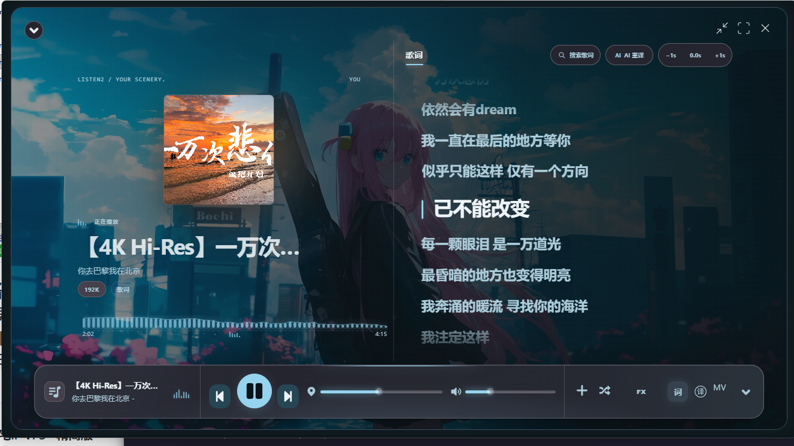
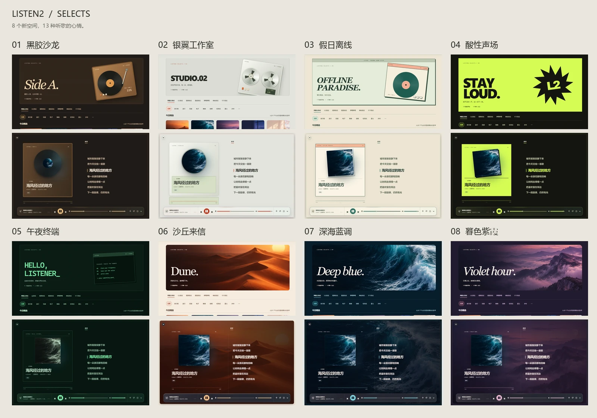
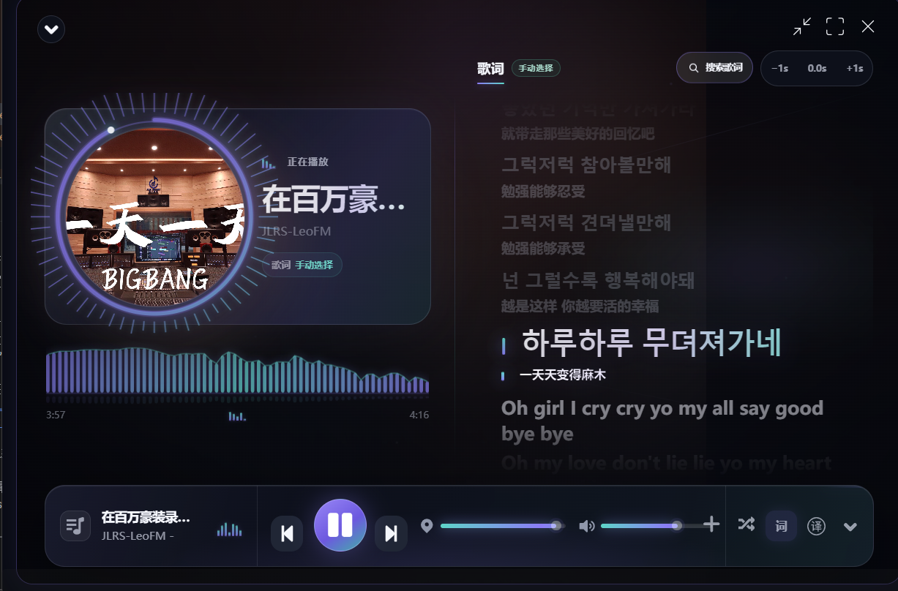
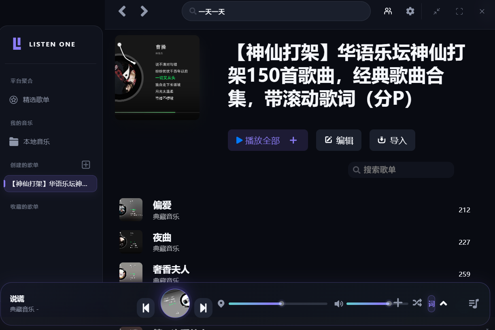

<div align="center">

# Listen2

### 把 Bilibili 与多平台音乐内容，整理成更好用的桌面播放器

[](./LICENSE.md)
[](https://github.com/dazzlingwuming/listen2/releases/latest)
[](https://www.electronjs.org/)
[](https://github.com/dazzlingwuming/listen2/releases/latest)
[](#平台支持)
[](https://github.com/listen1/listen1)

[下载最新版](https://github.com/dazzlingwuming/listen2/releases/latest) · [报告问题](https://github.com/dazzlingwuming/listen2/issues) · [构建说明](#本地开发与构建)

</div>

Listen2 是 [Listen1](https://github.com/listen1/listen1) 的社区增强版本。它保留多平台聚合搜索、播放和歌单能力，并重点改善 Bilibili 音乐播放、同步歌词、歌词翻译、桌面歌词、MV 和现代化桌面体验。

> Listen2 只整理和播放用户本来就有权访问的内容，不解锁会员、付费、DRM、地区限制或其他受限资源。



用户实机效果：选择喜欢的背景，侧栏、按钮、频谱和歌词高亮会一起跟随图片配色。

## v2.35.7 更新

- 新增「每日主题」：从顶部调色盘进入并选择后，按天获取必应首页图像；仅使用 `wp=true` 且标记可作为壁纸的图片，并展示必应提供的署名与说明链接。自动配色会跟随图像更新。
- 成功获取的图片会保存在本机；网络失败时继续显示上次成功的图片，不清空现有背景。必应图片的授权因图片而异，本功能不表示所有图片均可用于其他用途。
- macOS 保留普通 DMG 的拖装入口：将 `Listen1.app` 拖入“应用程序”。安装辅助不是必要步骤，不作为正常安装要求。浏览器下载后首次打开的系统拦截问题仍在核验，尚不能宣布已修复；本版没有新增签名或公证。

## v2.35.6 更新

**让照片成为主题。** 本次把主题馆扩展到 13 套内置主题，并加入可以自己上传图片的「我的风景」。

- 新增黑胶、金属工作室、泳池、酸性图形、终端、沙丘、海浪、紫色群山八套主题，各自包含首页与播放页设计。
- 导入 JPG、PNG 或 WebP 图片，自动提取颜色，匹配背景、按钮、频谱和歌词高亮；支持跟随图片、浅色和深色。图片仅保存在本机，重启后继续使用。
- 新增整个窗口的透明度调节（0–55%），所有主题通用，可一键恢复不透明，并自动记忆。
- 修复网易云搜索中的中文请求、异常返回和旧结果覆盖问题；歌曲与歌单支持分页，网络错误及官方验证状态有明确提示。保留结果的真实歌手，不把翻唱标为原唱。
- 改善手动歌词搜索：歌名与歌手组合无结果时尝试仅歌名，继续寻找有同步歌词的候选，找到的结果逐条显示；取消或超时后不再接收迟到结果。

点击顶部调色盘，进入「用自己的图片生成主题」即可使用。Windows 从托盘退出旧版后覆盖安装，无需先卸载。

已通过 183 项桌面测试、修改文件的 ESLint 检查与 Windows 安装包内功能验证；前端 25/27 通过，另两项为已确认的上游旧断言失败。使用方式、实测结果和验证范围见 [图片主题与搜索说明](https://github.com/dazzlingwuming/listen2/blob/v2.35.6/docs/PERSONAL_THEMES_AND_SEARCH.md)。

## v2.35.5 更新

- 新增“仅本应用直连”，仅影响本应用的搜索、播放、歌词、翻译和更新；电脑代理可继续供其他软件使用。
- 本应用使用独立安全 DNS，减少默认 Fake-IP 解析对应用网络请求的影响，并提供异步切换回执及设置保存、恢复。
- 修复 DeepSeek 翻译遇到不完整响应时的恢复处理（c9ce651）。

此功能不保证所有歌曲都能直连，也不承诺绕过系统级 TUN 网络接管；实际连接仍受系统网络环境和内容服务影响。

## v2.35.4 更新

- 手动歌词候选窗口保留右侧搜索区，并扩展候选列表可用高度。
- 来源阶段信息默认折叠；候选列表直接显示歌名、歌手、来源和时长。
- 窄窗口下仍可查看和操作候选，搜索与候选操作支持键盘使用。

已通过 26 项相关测试、4 项前端契约检查，以及 6 种窗口尺寸的布局与操作检查。在 1112×802 窗口中默认可完整看到 4 条候选。界面验证使用隔离的模拟搜索结果，未启动或替换用户正在使用的应用；实际安装与平台账号验证未在本轮覆盖。

## v2.35.3 更新

- 手动歌词搜索要求填写歌名，歌手可选；用户确认后才开始检索。修改输入会取消旧请求，避免旧结果覆盖新查询。
- 按来源展示目录、歌词、平台验证和超时等阶段信息；酷狗纯歌名搜索补齐目录检索链路。
- 对连接不可达地址增加有界的备用解析服务回退，限制额外尝试次数。
- 网易歌词新增官方验证入口，并在验证后复用专用持久会话。真实用户账号认证未在本次验证中覆盖；平台风控仍可能影响访问。
- macOS 延后 Keychain 检查，避免在启动阶段提前检查钥匙串。

102 项相关测试与 6 项契约检查通过，并核对了《折风渡夜》《青花瓷》的公开歌词样例。本次未验证安装界面、网易真实账号认证或 Windows 实机；歌词来源与网络服务仍可能波动。macOS 沿用 v2.35.1 的打包配置，不新增签名证书，也不作 Apple 公证承诺；安装包状态以本版本 Release 页面为准。

## 主题馆

现在有 **13 套内置主题**，导入图片后还可使用自动配色的「我的风景」。点击顶部调色盘按钮，或进入「设置 → 主题」，即可查看真实界面预览，按实体灵感、大胆图形、沉浸风景、插画、浅色和深色筛选；选择即时生效并记忆，不中断正在播放的音乐。

新增黑胶沙龙、银翼工作室、假日离线、酸性声场、午夜终端、沙丘来信、深海蓝调、暮色紫霞。各套包含独立的首页构图、播放页材质、歌词与播放栏配色，原有现代白、现代黑和三套插画主题继续保留。



场景图片随应用打包；黑胶转动仅在高画质模式且播放时启用，减少动态偏好优先。设计参考与素材提示词见 [主题素材记录](docs/THEME_ART.md)，验证范围见 [外观交付记录](docs/APPEARANCE_AND_WINDOWS.md#2026-10-23--主题馆扩展)。新增主题与自定义图片功能从 v2.35.6 提供。

## v2.35.2 更新

- 保留现代黑白，新增樱花来信、薄荷放学后、星夜电台三套原创动漫插画主题。
- 新增动态效果档位和长列表可视区域渲染；均衡模式频谱 30fps，减少动态模式仍保留 15fps 真实频谱。
- 修正本地缓存音频的频谱分析通路，以及 Windows 音频、歌词缓存的持久化。
- 手动歌词检索支持多来源、取消和重试，部分来源失败不会清空其他结果。
- 缓存与下载新增任务进度、取消、失败重试；自动缓存任务可升级为永久下载，已有缓存直接保留。
- 普通清理保留永久下载，删除失败保留索引并提示，网络下载不再阻塞索引管理。

### 下载与已知限制

Windows 安装版选择 `listen1_2.35.2_win_x64.exe`，免安装压缩包选择 `.7z`。macOS 提供 x64、arm64、universal DMG。

Windows 未使用商业代码签名；macOS 沿用 v2.35.1 的打包流程，按项目对 macOS 的明确选择不做代码签名或 Apple 公证。频谱与缓存后续修正通过语法和前端静态检查；未执行本轮自动化回归或实机播放回归。主题预览、首版实测数据及具体修正记录见 [交付记录](docs/APPEARANCE_AND_WINDOWS.md)，其中首版性能数字不代表本次全部改动的回归结果。

## v2.35.1 更新

- Windows 与 macOS 启动时发现新版本会显示版本号和 GitHub Release 更新内容。
- Windows 在用户确认后下载更新，下载完成后再次确认才会重启安装。
- macOS 在用户确认后打开对应版本的本仓库 Release 页面下载 DMG。
- 选择稍后或取消不会下载，也不会安装更新。

## v2.35.0 更新

- 新增“年度回响”：基于本机有效播放记录汇总年度听歌时间、歌曲、歌手和月度趋势；“添加到下一首播放”使用可恢复的 FIFO 队列。
- 新增八种桌面音效预设，可按偏好选择播放效果。
- DeepSeek 歌词翻译支持自定义翻译风格，并继续要求用户主动确认后才发送请求。
- 新增“缓存与下载”音乐库，集中管理临时缓存、歌单缓存和永久离线下载。
- 补全曲目时长持久化，并修复播放器底部停靠控件的重叠问题。

## 界面预览





## 功能亮点

### 现代化播放器

- 十三套主题，覆盖音乐库、播放详情、弹窗与底部播放栏；支持风格筛选、真实预览与一键切换。
- 沉浸式播放详情页，包含圆形封面、环形进度、背景氛围光和分层信息布局。
- 由真实音频分析驱动的频谱与动态效果，而不是与音乐无关的预设动画。
- 提供八种桌面音效预设、原音对比与失败回退；实际听感取决于播放设备和系统音频链路。
- 重新设计播放进度、音量、状态反馈和高频操作区域。
- 可选的曲目响度标准化会在播放时减少歌曲间的音量跳变，不修改原始音频，也不使用动态压缩冒充归一化。

### Bilibili 音乐、登录与 MV

- 支持 Bilibili 搜索、分 P 解析、音频播放、封面和作者信息展示。
- 自动清理“4K 修复”“无损”“动态歌词”等标题噪声，提取更可靠的歌名与歌手线索。
- 支持使用 Bilibili 客户端扫码登录；二维码在本地生成，不发送给第三方二维码服务。
- 登录后按账号和视频实际权限展示可用音质、画质，不绕过平台访问控制。
- 支持纯音频与 MV 切换、分 P、画质选择和全屏播放；MV 不可用时可退回纯音频。
- 音频地址失效或 CDN 异常时，按顺序尝试备用地址并有限刷新媒体信息。
- 区分临时网络故障、超时、内容不存在和权限错误，避免无限重试或连续误切歌曲。

### 歌词、翻译与 DeepSeek

- 支持同步歌词、播放偏移校正、当前行高亮和原文/译文双语显示。
- 为 Bilibili 内容从多个歌词来源检索候选，并综合歌名、歌手和时长进行匹配。
- 自动匹配不可靠时，可手动搜索、选择并保存当前歌曲的歌词来源。
- 优先使用当前歌词自带译文，其次寻找其他高匹配来源中的现成译文。
- 所有歌词源都没有译文时，可由用户明确确认后，调用 DeepSeek 翻译整首歌词。
- DeepSeek 翻译一次提交整首歌词，按原时间轴回填；结果行无法可靠对应时不会强行展示。
- 成功的机器翻译会缓存，减少重复请求和 API 费用。
- 桌面端会持久化成功的自动匹配歌词；用户手动选择后，该选择会替代自动结果并保持最高优先级。
- DeepSeek 成功译文会随对应歌词持久化，不再按固定歌曲数量静默淘汰；只有与当前原文完整对应的译文才会显示。
- DeepSeek API 密钥通过 Electron `safeStorage` 加密保存，不会返回给播放器页面。

> Listen2 不会在播放、切歌或加载歌词时自动调用 DeepSeek。只有用户在确认面板主动同意后才发送歌名、歌手和整首歌词；请求可能产生 DeepSeek API 费用。

### 桌面离线缓存

- 歌曲真正开始播放后，桌面端会低优先级后台缓存完整的 Bilibili 音频；第一次播放仍直接使用在线流，不等待下载。
- 未加入“我的歌单”且未被用户明确下载的音频属于临时缓存，只在当前会话复用，并在正常退出 App 时统一清理。
- “我的歌单”中的缓存会跨重启保留但仍参与容量淘汰；用户明确下载的歌曲会永久离线保留，只有用户主动取消或删除时才移除。
- 只有完整下载并通过校验的文件才会进入离线缓存，失败下载和临时文件不会交给播放器。
- 默认容量为 2 GB，也可选择 1 GB、5 GB、10 GB 或不限制；达到上限时仅按最近最少使用顺序清理音频。
- 缓存命中后可在断网时播放；本地文件损坏时会删除该项，并在网络可用时回到原有 CDN 恢复流程。
- 桌面侧栏的“缓存与下载”音乐库可搜索、排序和管理全部缓存曲目，筛选下载、歌单和临时缓存，并将现有缓存切换为永久离线下载；支持单首或批量删除。设置页仅保留缓存开关、容量、状态、清空、删除当前歌曲和跳转入口。
- Chrome 扩展不启用桌面音频缓存；缓存文件不会进入歌单备份或 GitHub Gist。

### 曲目响度标准化

- 桌面端可按需启用“统一曲目音量”，目标为流媒体常用的 `-14 LUFS`，并以 `-1 dBTP` 为峰值上限。
- 完整缓存的 Bilibili 音频会在本地后台测量整曲响度和 True Peak；分析不上传音频、不阻塞首次播放。
- 首次播放、尚未分析或无法安全解码分析的歌曲保持原音量，不会在播放过程中突然追踪调节。
- 已分析歌曲只在播放时应用固定增益，保留歌曲内部的动态关系；用户音量、静音和系统音量仍然独立。
- 响度结果与缓存文件内容哈希绑定；临时清理或容量淘汰会保留小型响度档案，只有再次取得完全相同的音频字节时才复用。用户主动删除缓存或当前歌曲本地数据时会一并移除。

### 桌面歌词与播放控制

- 支持桌面歌词置顶、拖动、透明度、字号、颜色和双语显示。
- 未锁定时可直接控制上一首、播放/暂停和下一首，并显示真实播放状态。
- 锁定后歌词区域支持点击穿透，同时保留明确的解锁入口。
- 针对 macOS 多桌面空间和全屏应用做了单独窗口适配；Windows 使用对应的原生置顶行为。

### 更可靠的随机播放

- 使用 Fisher–Yates 洗牌生成每轮随机队列。
- 一轮内每首可播放歌曲只出现一次，新一轮避免立即重复上一首。
- “上一首”沿真实播放历史返回，重启播放器后也会正确恢复随机模式。

### 年度回响与“下一首播放”

- 桌面端默认在本机记录实际向前播放的时长；暂停、缓冲和拖动进度不会伪造听歌时间。
- 一首歌曲播放超过 30 秒，并达到歌曲一半时长或 4 分钟（取较小值）后，才计为一次有效播放。
- “年度回响”汇总总听歌时间、有效播放、歌曲和歌手数量、年度歌曲、年度歌手与月度趋势；没有足够数据时会明确显示空状态。
- 听歌记录仅保存在当前设备，不包含搜索、歌词、页面或设置行为；可随时关闭、导出或清除。
- 歌曲菜单中的“添加到下一首播放”使用独立 FIFO 队列：连续添加多首会严格按添加顺序播放，完成后回到原歌单、随机或单曲循环上下文。
- 下一首队列支持重复歌曲、上移、下移、删除、清空和重启恢复；列表中的曲目时长统一显示为 `分:秒` 或 `时:分:秒`。

### 安全的歌单备份与跨设备导入

- 新备份文件只包含我的歌单和收藏歌单，不导出登录凭据、本地音乐路径、主题或歌词设置。
- 本地文件与 GitHub Gist 默认使用合并导入：保留当前设备的歌单，再追加备份中的歌单。
- 完全相同的歌单会跳过；同名歌单可独立保留，ID 冲突但内容不同时会生成新 ID，不覆盖本机版本。
- 兼容旧版 `listen1_backup.json`；“覆盖当前歌单”仍保留为需要应用内二次确认的高级选项。

## 下载与安装

前往 [GitHub Releases](https://github.com/dazzlingwuming/listen2/releases/latest) 下载适合当前系统的安装包。

### Windows

下载 Windows 10/11 x64 的 NSIS 安装包或 7z 压缩包。目前安装包未使用商业代码签名证书，Windows SmartScreen 可能显示“未知发布者”；请核对下载来源和 Release 页面。

### macOS

Intel Mac 下载 x64 DMG，Apple Silicon（M 系列）下载 arm64 DMG；Universal DMG 同时支持两者。打开 DMG 后将 Listen1 拖入“应用程序”。

下载 DMG，将 `Listen1.app` 拖入“应用程序”。当前版本未新增 Apple Developer ID 签名或公证，首次从浏览器下载后仍可能被系统拦截；这个行为正在按真实下载安装路径核验。安装脚本不作为正常安装前提，也不能用它的校验通过来代表直接安装成功。

如果未使用安装辅助，或你选择不运行它，请按系统提示在“系统设置 → 隐私与安全性”允许打开 Listen1；不要关闭 Gatekeeper。

系统确认和钥匙串授权取决于本机状态；不能保证所有版本都免提示或免密码。若系统未提供“仍要打开”，请保留提示文字并反馈。

本版本只发布 Windows x64 的 NSIS 与 7z，以及 macOS x64、arm64 和 Universal DMG；不发布 Linux、Windows ia32 或 Windows arm64 制品。

## 平台支持

核心播放器界面、Bilibili 适配、频谱和歌词逻辑由 Windows 与 macOS 共享。操作系统原生窗口行为会有少量差异。

| 平台                        | 状态     | 说明                                                                       |
| --------------------------- | -------- | -------------------------------------------------------------------------- |
| Windows 10/11 x64           | 发布目标 | 提供 NSIS 安装包与 7z；包含现代 UI、Bilibili、MV、桌面歌词与 DeepSeek 翻译 |
| macOS Intel / Apple Silicon | 发布目标 | 提供 x64、arm64 与 Universal DMG；按项目选择不做代码签名或 Apple 公证      |
| Windows ia32 / arm64        | 不发布   | 本版本不提供对应制品                                                       |
| Linux                       | 不发布   | 本版本不提供 Linux 制品                                                    |

## 使用提示

### Bilibili 登录

在账号区域选择 Bilibili 登录并使用手机客户端扫码。登录 Cookie 保存在 Electron 会话中，刷新令牌使用系统安全存储加密；退出登录会同时清理服务端会话与本地数据。

### 网易歌词验证

手动歌词搜索提示“需要完成平台验证”时，点击该来源旁的“去验证”，在网易官方页面操作后关闭窗口。应用会复用同一网易会话重新搜索；窗口关闭本身不表示验证成功。平台下发的有效持久 Cookie 由专用本机会话保存，后续网易歌词请求自动使用，其他歌词来源不携带这些 Cookie。

Cookie 到期、被平台撤销或再次触发验证时仍需重做验证。验证入口失效时先重新搜索获取新入口。此过程不改变播放代理或系统 DNS，也不会把 Cookie 写进安装包或 GitHub。

### DeepSeek 歌词翻译

1. 在设置中填写自己的 DeepSeek API 密钥并测试连接。
2. 播放有同步歌词但没有现成译文的歌曲。
3. 在翻译确认面板查看说明，主动确认后才会发起翻译。
4. 如不再使用，可在设置中清除密钥。

机器翻译仅在 Electron 桌面客户端提供，Chrome 扩展模式不支持该能力。

## 本地开发与构建

### 环境要求

- Node.js 18 或更高版本
- npm
- Windows 或 macOS 桌面系统

### 运行开发版

```bash
git clone https://github.com/dazzlingwuming/listen2.git
cd listen2
npm ci
npm run start
```

前端代码已经位于 `app/listen1_chrome_extension`，不需要额外初始化 Git 子模块。

### 构建安装包

```bash
# Windows x64 NSIS 安装包与 7z 压缩包
npm run dist:win

# macOS x64、arm64 和 Universal DMG
npm run dist:mac
```

构建产物位于 `dist/`。macOS 沿用 v2.35.1 的 electron-builder 流程；项目仅对 macOS 明确选择不做代码签名或 Apple 公证，不配置签名 hook、不要求创建本机签名证书或修改钥匙串信任。此策略不代表 Windows 构建的签名状态。

### 运行测试

```bash
npm run test:bilibili
npm run test:desktop-cache
npm run test:loudness
npm run test:desktop-lyric
npm run test:machine-translation
npm run test:listening-history
npm --prefix app/listen1_chrome_extension test
```

## 项目结构

```text
listen2/
├─ app/
│  ├─ main.js                    # Electron 主进程、IPC 与桌面窗口
│  ├─ bilibiliService.js        # Bilibili 登录、媒体清单与会话管理
│  ├─ audioCache.js             # 桌面端完整音频缓存、容量与 Range 服务
│  ├─ lyricCacheStore.js        # 自动/手选歌词及译文持久化
│  ├─ machineTranslation.js     # DeepSeek 歌词翻译与结果校验
│  ├─ floatingWindow.html       # 桌面歌词窗口
│  └─ listen1_chrome_extension/ # 共用播放器前端与音乐平台适配
├─ build/                        # 应用图标与打包资源
├─ docs/                         # 设计、验证与实现文档
├─ 图片/                         # README 界面预览
├─ package.json                  # 开发、测试与打包配置
└─ README.md
```

## 已知限制

- 音乐平台、歌词接口和 Bilibili Web 接口可能变化，无法保证所有来源永久可用。
- Bilibili 标题不总是包含规范的歌名和歌手；匹配不确定时请使用手动歌词搜索。
- 登录只使用账号实际拥有的访问权限，不保证获得固定音质或画质。
- MV 可用性受视频、地区、CDN 和设备解码能力影响；不可用时请继续使用纯音频模式。
- 逐词高亮需要歌词源提供逐词时间戳；普通 LRC 只能可靠地逐行同步。
- 机器翻译需要用户自行配置 DeepSeek API 密钥，翻译准确性和费用由对应服务决定。
- 离线缓存只覆盖已成功播放并完整缓存的 Bilibili 音频；第一次播放仍需要网络。
- 响度分析器会把解码器支持的来源采样率统一重采样到 48 kHz 分析域；超过时长或资源限制、无法解码的完整 Bilibili 缓存保持原音量。

## 贡献

欢迎提交 Issue 或 Pull Request，尤其欢迎以下方向：

- Bilibili 接口兼容、媒体播放与元数据识别
- Windows、macOS 和 Linux 实机兼容反馈
- 歌词匹配准确率、多语言翻译与无障碍体验
- 播放性能、网络恢复和界面优化

提交问题时，请尽量附上系统版本、复现步骤、内容来源链接和必要日志；请勿上传受版权保护的音频文件、登录 Cookie 或 API 密钥。

## 开源许可与致谢

本项目基于以下开源项目继续开发：

- [listen1/listen1](https://github.com/listen1/listen1)
- [listen1/listen1_desktop](https://github.com/listen1/listen1_desktop)
- [listen1/listen1_chrome_extension](https://github.com/listen1/listen1_chrome_extension)

项目继续使用 [MIT License](./LICENSE.md)。感谢 Listen1 的作者和所有贡献者建立了这个项目的基础。

## 免责声明

Listen2 本身免费、开源，不托管、不上传、不销售任何音乐或歌词内容，也不提供绕过付费、DRM 或平台访问控制的功能。搜索结果、音频、视频、封面和歌词来自相应第三方平台，相关权利归原权利人所有。

使用者应遵守所在地法律法规、内容版权要求及第三方平台服务条款。本项目仅供学习、研究与个人使用。
