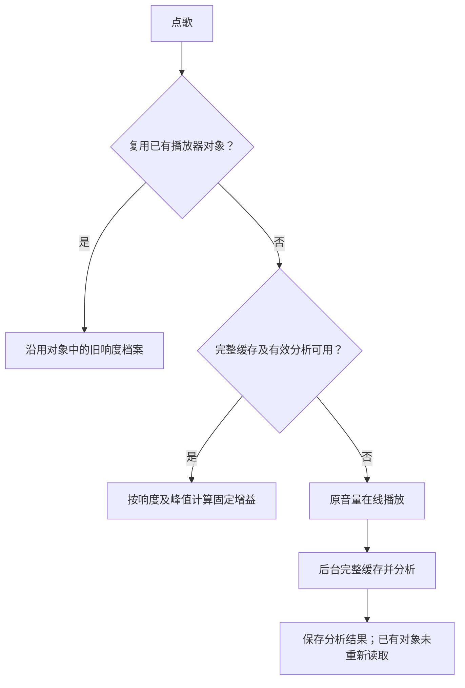

# 桌面曲目响度平衡：诊断与改进建议

日期：2026-10-21，Asia/Shanghai。范围：Electron 桌面版，重点为 Bilibili 音频。状态：**分析完成；以下实现方案尚未执行。**

## 1. 结论

用户希望在电脑和播放器音量不变时，切换歌曲的听感音量尽量接近。现有功能具备整曲响度测量和固定增益基础，但存在两类有证据的问题：

1. **生效时机有缺口：**后台分析完成后，已有播放器对象继续持有未分析时的旧档案；同会话重播、重新打开统一音量开关，可能仍以原音量播放。
2. **保留动态的策略有边界：**安静歌曲若已有接近上限的瞬时峰值，固定增益几乎无法放大，仍会比其他歌曲轻。要进一步拉近这类歌曲，需要降低共同目标，或接受对少量峰值的限幅处理。

此外，首次在线播放没有完整分析、失败结果不自动重试、分析资源上限，以及归一化后的音效处理，都会影响覆盖或最终听感。

上述软件缺口已通过源码和合成控制流复现。**尚未对用户具体歌曲进行输出计量和听测，不能宣称已确定每一次音量差的原因。**

## 2. 本次检查对应的版本

- 发布基线：`origin/main` / v2.35.5，`5b5f90d891824cc5e339df78f3d546cb9f5d5b3e`。
- 分析使用的桌面工作树 HEAD `c45a3dfe76a6ee91d72c8658151bbe58179473e8` 与上述 main 的源码树内容相同，`git diff origin/main` 为空。
- 本机安装仍是上一任务实际安装的 2.35.4 候选；8 个响度、缓存和播放关键文件与分析源码一致。HTML 有差异，但两处响度开关控件均存在。
- 本轮未重启、替换或操作播放，未更改用户设置、系统音量、网络、原始音频。

## 3. 当前处理路径



音频实际经过 `HTML5 media → 独立曲目 Gain → 音效 → 输出`。MV 视频本身静音，音频仍由同一 Howl 播放；本轮未发现独立 MV 声轨绕过响度处理的证据。

### 3.1 已证实：分析完成后仍可能不生效

- [player_thread.js](../../app/listen1_chrome_extension/js/player_thread.js):1348：已有 Howl 和 URL 时直接结束加载，跳过新的缓存/响度查询。
- 同文件:292：切换统一音量只重算对象里已有的档案。
- 同文件:1651、1733：远程回退清空响度增益，本地缓存命中时才注入分析结果。
- [audioCache.js](../../app/audioCache.js):717：后台完成后保存分析结果；当前播放对象没有对应更新。
- [play.js](../../app/listen1_chrome_extension/js/controller/play.js):463：状态轮询刷新开关等状态，没有为旧播放器对象补取档案。

纯合成复现：先在线播放且没有分析结果；随后模拟缓存与分析 ready；再次播放并重新启用统一音量，查询次数仍为 1，线性增益仍为 1。显式重建播放器后，查询次数变为 2，取得应有的 `0.501187`（−6 dB）增益。

它说明“已经分析过”与“当前实际使用分析结果”需要分别验证。用户当前各首歌是否遇到此路径，仍需实际播放边界验证。

### 3.2 已证实：峰值上限限制安静歌曲的放大

整曲响度（LUFS）描述平均听感；True Peak 描述可能造成溢出的瞬时峰值。现在的策略是：

```text
增益 dB = clamp(min(−14 − 整曲 LUFS, −1 − True Peak), −24, +12)
```

来源：[loudnessAnalyzerRenderer.js](../../app/loudnessAnalyzerRenderer.js):263 和 [audioCache.js](../../app/audioCache.js):188。缓存层也重新校验此公式。

| 合成歌曲条件                              | 现有增益 | 线性处理后响度 |
| ----------------------------------------- | -------: | -------------: |
| 较响：−8 LUFS，峰值 −1 dBTP               |    −6 dB |       −14 LUFS |
| 较轻但有高峰：−24 LUFS，峰值 −1 dBTP      |     0 dB |       −24 LUFS |
| 较轻且峰值有余量：−20 LUFS，峰值 −10 dBTP |    +6 dB |       −14 LUFS |

前两首处理后仍相差 10 LU。单纯把 +12 dB 最大增益调大，无法解决峰值约束。

### 3.3 本机最少索引聚合：功能确有数据基础

只读取索引中必需字段并输出聚合；未保存歌曲名、媒体标识、内容哈希、URL、音频或歌词。

- `settings.enabled=true` 为音频缓存开关。
- `settings.loudnessNormalizationEnabled=true` 为统一曲目音量开关。
- 417 个缓存条目与 61 个独立 archive 键中，当前分析版本、身份有效的 ready 分别为 416 和 60，共 476；failed 共 2。

| 当前完整缓存的 416 个 ready 条目  |         数量 |
| --------------------------------- | -----------: |
| 若增益正确应用，预计在 −14±0.5 LU | 365（87.7%） |
| 预计仍低于目标超过 1 LU           |           37 |
| 预计仍低于目标超过 3 LU           |            8 |
| 预计仍低于目标超过 6 LU           |            1 |
| 固定增益受 True Peak 约束         |           68 |
| 触发 −24 / +12 dB 硬增益边界      |            0 |

后三档差距计数为包含关系，不能相加。68 个峰值受限条目中也有一些距离目标很近。

输入响度范围 −25.14 至 −4.58 LUFS；根据档案推算应用固定增益后范围为 −21.51 至 −14 LUFS，中位数 −14 LUFS。独立 archive 的 60 个 ready 中，50 个预计在目标范围，11 个受峰值限制。

**这些是持久化档案推算，不是正在播放时的实际增益或扬声器输出测量。** 输出响度按原始档案 LUFS 加曲目增益推算，未计入播放器音量、音效或系统音量。数据说明分析器并非全部失效；优先查清结果能否在每次播放时实际生效很有价值。

### 3.4 其他覆盖限制

- [audioCache.js](../../app/audioCache.js):678、710：同音频 hash、同分析器版本的 `failed` 也被视为 current，后续排队直接跳过。已有下载重试入口不等同响度分析重试。本机只有 2 个失败记录，不能把它当作本机多数歌曲问题的证据。
- [loudnessAnalyzer.js](../../app/loudnessAnalyzer.js):16、214：分析单文件限制 96 MiB，外层超时 120 秒；缓存单文件允许 128 MiB。
- [loudnessAnalyzerRenderer.js](../../app/loudnessAnalyzerRenderer.js):8：分析域 48 kHz、最多 6000 万采样值；立体声实际受限为 625 秒（10 分 25 秒），会早于名义 15 分钟时长上限。六声道约为 208 秒；超限保持原音量。
- [audio_visualizer.js](../../app/listen1_chrome_extension/js/audio_visualizer.js):497：音效在曲目增益后处理；EQ、预衰减、soft shaper 和夜间压缩可再次改变最终响度。当前用户音效档位未核实。
- 整曲固定增益保留内部动态，无法保证两首歌的安静开头、高潮片段或混合人声视频的每个瞬间同响。
- [bilibiliService.js](../../app/bilibiliService.js):169、1051 和 provider bootstrap 白名单没有保留上游 `volume / measured_i / measured_tp`。合成字段输入确认会被丢弃；未验证实网是否稳定提供、单位是否相符、是否绑定当前音质，暂不能以此作为首播方案的可靠前提。

## 4. 成熟方法与官方开源项目

成熟流程通常是“标准测量 + 播放增益策略 + 必要时限峰”。测量库不会自动解决播放器旧状态或首次在线播放覆盖。

- 测量依据：[ITU-R BS.1770-5](https://www.itu.int/rec/R-REC-BS.1770-5-202311-I/en) 定义节目响度与 True Peak 测量；[EBU R128](https://tech.ebu.ch/publications/r128) 的广播目标与本应用的流媒体目标应分别理解，不能把 −14 LUFS 说成 EBU 唯一要求。
- [Spotify 官方说明](https://support.spotify.com/us/artists/article/loudness-normalization/)采用 −14 LUFS 普通模式，并为安静歌曲保留峰值余量；其示例中 −20 LUFS / −5 dBFS 的歌曲只提高到 −16 LUFS。较响模式会使用限幅，体现音量一致性与保留峰值之间的取舍。

| 官方项目                                                            | 能解决的部分                                                  | 对当前项目的建议                                                                                              |
| ------------------------------------------------------------------- | ------------------------------------------------------------- | ------------------------------------------------------------------------------------------------------------- |
| [jiixyj/libebur128](https://github.com/jiixyj/libebur128)           | C 实现，MIT；整曲、短时、瞬时响度、响度范围和 True Peak       | 用作测量基准；需另做解码、应用增益和限幅。可评估原生或自行构建的 WASM，不能把未经验证的 JS 包装视为等价成熟度 |
| [sdroege/ebur128](https://github.com/sdroege/ebur128)               | Rust 移植，MIT；官方声明与 C 版结果一致且通过 EBU 测试        | 若选择 Rust/WASM 路线，是可评估的测量内核；本轮未验证本项目的构建与实时集成                                   |
| [FFmpeg](https://github.com/FFmpeg/FFmpeg)                          | 解码、响度扫描、`loudnorm` 与 `alimiter`                      | 适合离线参考计量及后台处理。保留 Electron 当前播放链时，不建议为此先整体更换播放器                            |
| [slhck/ffmpeg-normalize](https://github.com/slhck/ffmpeg-normalize) | Python/FFmpeg 批处理，默认双遍 EBU 分析与处理，可输出前后统计 | 适合做独立验证工具和离线对照，不宜让实时播放依赖 Python 转码                                                  |

[loudgain](https://github.com/Moonbase59/loudgain)也值得参考：以 ReplayGain 2.0、−18 LUFS 扫描并记录增益，保留音频波形；其 README 明示维护者近期时间有限，且项目偏本地文件标签工具。适合学习档案策略，不作为本次实时播放核心的首选。

当前上游状态只作调查快照：libebur128 未归档、最新 release v1.2.6（2021-02-14），不能因稳定库发布较早就直接判为不可用；ffmpeg-normalize 最新 release v1.43.0（2026-10-14）。尚未引入任何新依赖。

FFmpeg 官方文档说明 [`loudnorm`](https://ffmpeg.org/ffmpeg-filters.html#loudnorm) 的线性模式须满足测量参数、响度范围及峰值条件，否则会回退动态模式；不能把 `linear=true` 当成绝不改变动态的保证。[`alimiter`](https://ffmpeg.org/ffmpeg-filters.html#alimiter)有前瞻延迟，默认自动电平选项也要明确控制。Web Audio 的 [DynamicsCompressorNode](https://www.w3.org/TR/webaudio/#DynamicsCompressorNode) 是动态压缩器，不能仅凭节点名称或阈值把它验收为严格 −1 dBTP 限幅器。

## 5. 推荐分阶段改进

### 第一阶段：让已有分析在播放时可靠生效

这一阶段保持现有保留动态策略，优先修复可复现的软件缺口：

1. 每次新的播放边界重新确认当前媒体的缓存/响度身份，避免复用旧 Howl 跳过查档；播放进行中不因后台完成而突然跳变音量。
2. 保持音频字节 hash、版本和音质绑定。只有同一媒体字节的档案才能用于该流；不能仅靠歌曲 ID 对未确认音质的在线流套用旧增益。必要时在下一次播放切到已校验缓存。
3. 区分“设置已打开”和“当前歌曲实际已生效”，提供已均衡、分析中、失败、受峰值限制等可理解状态。
4. 暂态分析失败允许有界重试；不支持、损坏或超限明确说明，避免永久静默原音量或无限重试。
5. 让资源限制、进度和说明相符；用独立标准测量核对自研分析器，不能因单元测试通过就宣称已符合完整标准套件。

预计主要涉及 `audioCache.js`、`player_thread.js`、`loweb.js`、播放/设置状态和相关测试；是否更换测量内核由对照结果决定。

### 第二阶段：提供适合用户目标的舒适均衡

| 模式                 | 行为                                                                   | 实际取舍                                                                                                       |
| -------------------- | ---------------------------------------------------------------------- | -------------------------------------------------------------------------------------------------------------- |
| 保留动态             | 整曲固定增益，峰值不足时少放大；可评估较低共同目标                     | 保留歌曲内部轻重，极端高动态歌曲仍可能较轻                                                                     |
| 舒适均衡（建议新增） | 标准响度校准，最终输出适度限峰；未知首播使用有门控的短时估计和平滑增益 | 目标是进一步拉近切歌音量；限峰可能改变瞬时峰值，首播调整可能改变短时动态；效果、适应时间、失真和延迟待原型验证 |

建议从舒适均衡原型进行对照，保留原有模式供选择。先比较 −16 / −18 LUFS 等较保守目标，以减少持续限幅；目标数值是待验证的工程参数，不让用户承担 LUFS 调参。

实时部分宜在既有 Web Audio 链中评估 [AudioWorklet](https://developer.mozilla.org/en-US/docs/Web/API/AudioWorklet)，处理短时估计、静音门控、平滑与限峰，避免在 UI 线程轮询瞬时音量；测量内核用标准实现或经过独立校准的现有实现。最终限峰应在音效之后验证，并确认用户音量、静音、原音对比和 MV 同步不被破坏。

精确整曲 LUFS 需要完整音频或可信上游档案。未知曲目若立即播放，只能先估计，不能保证第一毫秒就和下一首同响。不能为了快速首播只取安静前奏作为整曲响度，也不能在静音段无限提升增益。

原音频无需重写或重复有损编码。若未来采用 FFmpeg，优先输入由应用现有受控网络链获取并校验的本地媒体或数据，不直接让子进程拿远程签名 URL，以免另建网络路径破坏“仅本应用直连”的既有修复；打包按所选官方构建配置核对其分发要求。

## 6. 实施后的验收建议

先用 1–2 对具有代表性的合法音频验证，再扩展小批量：

1. 一对常规响歌与安静高峰歌；另一对含安静前奏或视频混合内容。
2. 覆盖首次在线播放、缓存未分析、后台完成后同会话重播、切回旧歌曲、开关切换、失败重试、资源超限和原音/音效模式。
3. 明确计量采集位置，固定播放器及系统音量，比较处理前后的独立 LUFS / True Peak 计量；曲间差在相同音量下比较，绝对 LUFS 目标与 True Peak 上限在约定处理节点验证。分析 ready 的普通材料可先以曲间差 ≤1 LU 为工程目标，峰值受限例外明确报告；未知首播另测适应时间与切入峰值，不能混作整曲通过。
4. 舒适模式验收最终音效后输出的 True Peak、削峰量、失真/抽吸感和新增延迟；超过限幅预算时降低共同目标或明确例外，不能以持续重压换取数字达标。
5. 确认暂停、拖动、切歌、静音、原音对比、MV 同步、在线/缓存切换无无声、双声或突变，并由用户固定音量进行实际试听。

## 7. 已执行验证与限制

| 命令/检查                                                                      | 时间（+08:00）               | 结果                                           |
| ------------------------------------------------------------------------------ | ---------------------------- | ---------------------------------------------- |
| `npm run test:loudness`，TMPDIR 为登记 workspace                               | 2026-10-21 08:49:34–08:49:35 | 18/18，exit 0                                  |
| `node app/listen1_chrome_extension/test/desktop_cache_player_behavior.test.js` | 2026-10-21 08:49:38          | 脚本级测试通过，exit 0                         |
| 原模块合成数值、旧 Howl、failed 跳过和上游字段白名单复现                       | 2026-10-21 本轮诊断          | 全部断言通过，exit 0；正式复现脚本见下         |
| 安装 ASAR 对应源码比较与最少索引聚合                                           | 2026-10-21 本轮诊断          | 关键处理文件相符；只读聚合，未保存个人媒体内容 |

正式复现入口：在仓库根目录执行 `node doc/2026-10-21/loudness-diagnosis-reproduce.cjs`。该脚本只使用合成元数据与 MockHowl，不取网络音频、不操作用户 App；它固定当前基线缺口的预期，未来修复后应由对应修复回归测试替换这些缺口断言。

未覆盖：真实 Electron 最终音频输出、用户代表歌曲听测、独立计量器实音频交叉校准、Windows 实机、全部平台和音效、完整 EBU 合规套件。现有单元测试通过不能替代这些验收。

恢复与下一步：本轮没有产品行为或配置变更，无需运行回滚；已交付诊断和分阶段建议。按 `COLLABORATION.md` 的实施前计划确认要求，舒适模式涉及音质/首次播放策略取舍，获得用户确认后再实施；本轮不发布安装包或合并产品改动。
