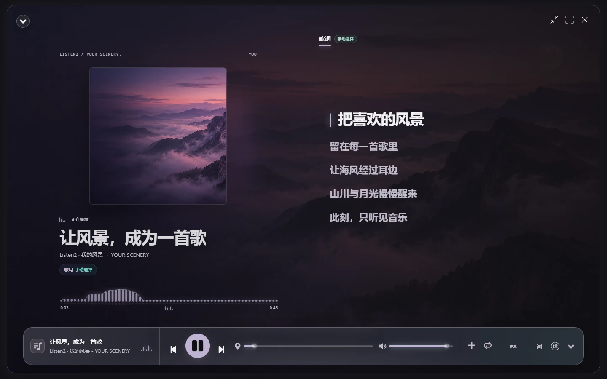
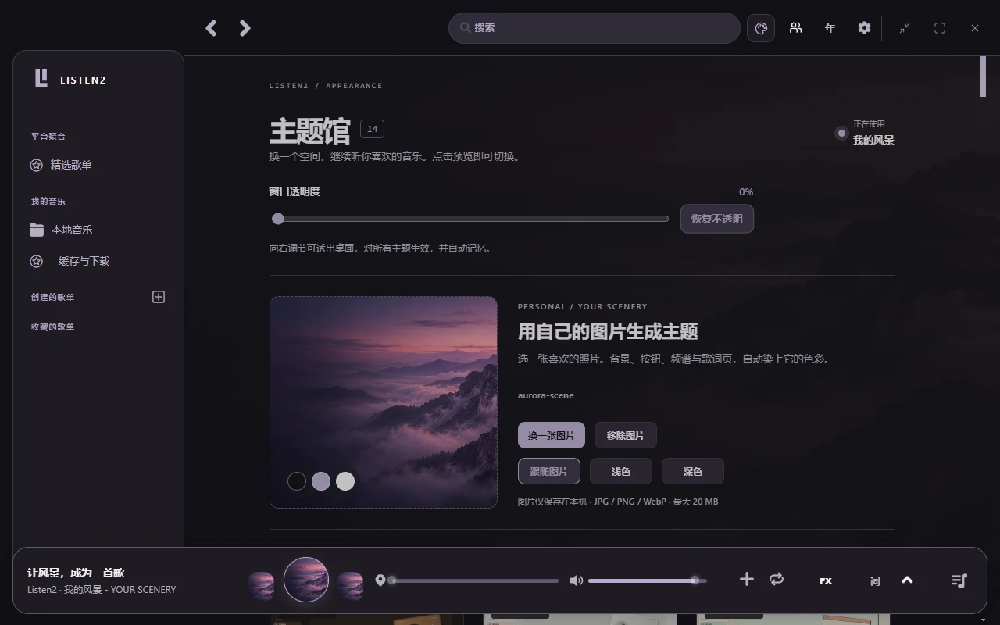

# 2.35.6：图片主题、透明度与搜索修复

## 使用

点击顶部调色盘进入主题馆。现在可以选择自己的 JPG、PNG 或 WebP 图片（最大 20 MB），自动生成「我的风景」主题。照片会成为首页和播放页背景；侧栏、文字、按钮、频谱及歌词高亮使用提取的配色。支持跟随图片、浅色和深色三种模式。

图片会在本机缩放到最长边 1920 像素，以 WebP 存入 IndexedDB；不会上传到服务端，也不依赖原始图片的文件路径。关闭并重新打开仍可继续使用。移除图片后恢复原有主题列表；导入失败保留旧图片。

主题馆上方的「窗口透明度」对所有主题生效，范围为 0–55%，可以一键恢复不透明。Windows/macOS 使用原生窗口透明度，设置在桌面配置中保存；不影响独立桌面歌词窗口。Linux 和普通浏览器不显示这项原生窗口选项。

## 搜索修复

- 先将本地项目从 `29f2f7d` 同步到 GitHub `main` 的 `5b5f90d`，保留 13 套主题的全部本地改动。上游新增的酷狗歌词源、歌名/歌手输入、网易官方验证、直连网络策略和翻译修复一并保留。
- 网易云歌曲及歌单搜索改用 `/api/search/get/web`；原来的 `/api/search/pc` 在本机实测返回 `-462`。中文与特殊字符使用标准 URL 参数编码，支持歌曲和歌单的有界分页。若接口声明成功但返回不可解析的字符串，只对同一公开查询做一次不携带登录信息的重试，合计最多 8 秒；明确要求官方验证时仍显示验证入口。
- 保留服务返回的真实歌名、歌手、专辑和时长，兼容 `artists/album` 与 `ar/al` 两种字段；空结果、异常数据、网络失败、需要官方验证分别显示。
- 普通音乐搜索加入输入防抖和请求编号。切换歌名、平台、结果类型、分页，或者清空输入时，旧响应不能覆盖新结果；超时后结束加载，并提供重试及切换平台。
- 手动歌词搜索保留明确的歌名和歌手；组合查询无结果时，各来源最多尝试一次仅歌名查询，歌手仍参与排序。
- 网易云、QQ 歌词从最多前 12 个手动候选中寻找可用同步歌词，每个来源最多两条下载任务并行、最多返回 6 个结果；可用结果立即展示。总检索有 20 秒截止时间，取消及超时后不再接收迟到结果。

歌曲目录和版权不会因接口修复而改变。《青花瓷》在网易云的返回结果包含翻唱等版本，不能据此宣称是周杰伦原唱。

## 验证

- 桌面自动测试 183 项通过，包含新增的取色对比度、窗口透明度、Unicode 搜索、乱序响应、超时及歌词逐条返回测试。
- 前端检查 25/27 通过。两项失败均已用未修改的 `HEAD` 源码复现：缓存页面数量断言仍要求 2 次而实际为 4 次；歌词翻译测试对上游已变更的提示词作旧字符串断言。未修改这些断言来隐藏失败。
- 修改的前端 JavaScript 通过 ESLint。所有主题及新功能在隔离的 Electron 用户目录中验证。
- 实测海浪、紫色群山和沙丘三张图片会生成不同配色；1440、1024、600 像素宽窗口无横向溢出。验证了图片显示、明暗切换、刷新恢复、损坏图片保留旧主题以及移除后的持久存储清理。
- 实际操作滑块后，原生窗口不透明度读值为 0.68，对应透明度 32%；落盘配置一致，一键恢复后读值为 1。
- 播放本地测试音频期间更换图片和明暗模式，音频实例保持一致且继续播放。
- Electron 中实际网易云搜索《西海情歌》返回 20 条，首条为刀郎；《青花瓷》返回 20 条，其中包含翻唱版本。
- 实际快速输入、清空搜索、歌曲第二页和歌单检索均通过界面与真实接口验证；歌曲第二页及歌单分别返回 20 条。
- Electron 中「青花瓷 / 周杰伦」歌词检索返回 15 个同步候选：QQ 6、酷狗 1、网易云 6、酷我 2，其中 QQ 和酷狗包含周杰伦版本；LRCLIB 当次网络不可用。平台可用性会随网络和服务变化。
- 从最终 EXE 提取 `app.asar`，与构建目录归档的 SHA-256 一致；核对了 45 个源文件、元数据及主题资产。直接载入安装包代码验证 13 套内置主题、16 张预览/场景图片、自定义图片导入、浅色模式、窗口透明度和刷新后的设置恢复，全部通过。未实际执行安装向导或验证用户真实账号登录。

下方测试预览中的歌曲信息和短歌词是隔离测试素材；README 顶部另展示用户提供的实际使用截图。验证没有改动用户正在运行的安装版、账号、歌单和配置，也没有自动安装。

## 构建

本地 Windows x64 安装包版本为 2.35.6，保留 Listen1 的应用标识和安装路径。构建明确使用 `--publish never`，并设置 `nsis.deleteAppDataOnUninstall=false`。安装前从托盘退出旧版，然后覆盖安装到原目录。

正式发行入口为 [Listen2 v2.35.6](https://github.com/dazzlingwuming/listen2/releases/tag/v2.35.6)。仓库发布流程构建 Windows x64 安装包与压缩包，以及 macOS Intel、Apple Silicon 和 Universal 安装包；本次已实测的 Windows `personal-themes` 套装也作为附件保留。自动更新使用发布流程生成的 `latest.yml`，本地实测套装提供单独的更新清单。macOS 构建验证以 GitHub Actions 结果为准，未进行本机 macOS 交互测试。

- 文件：`dist/personal-themes/listen2_2.35.6_personal-themes_win_x64.exe`
- 大小：83,552,300 字节（约 79.7 MiB）。
- SHA-256：`48e361ee4d5992abbc63e14e9dd16b7a6c3d90d9b3ab605037e9fad4a1e6287d`。
- 另有同目录 `.7z` 免安装压缩包；日常更新优先使用 `.exe` 覆盖安装。
